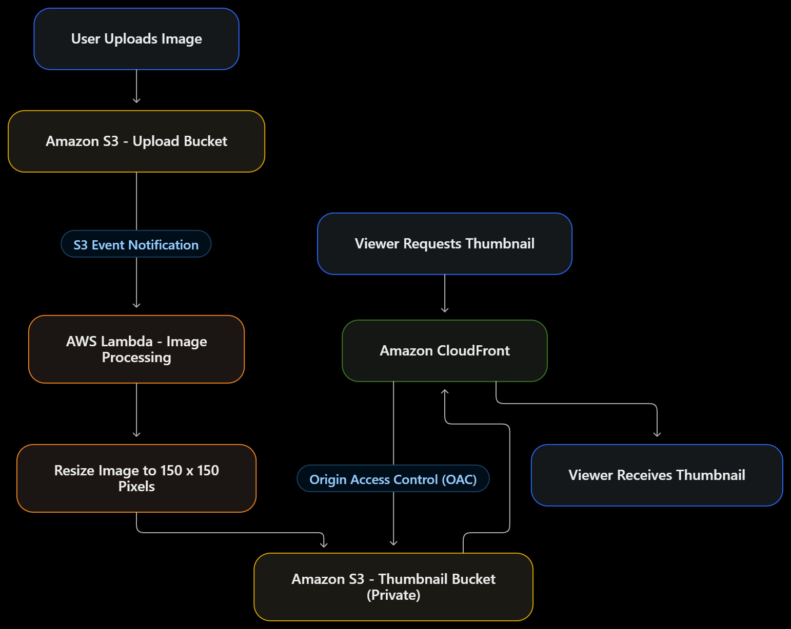
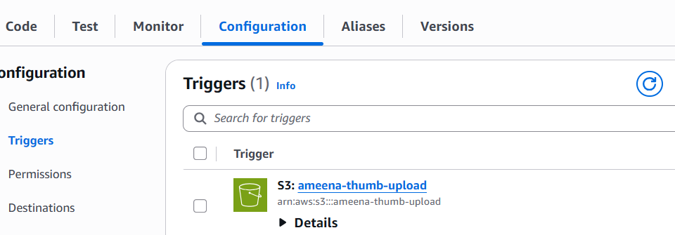
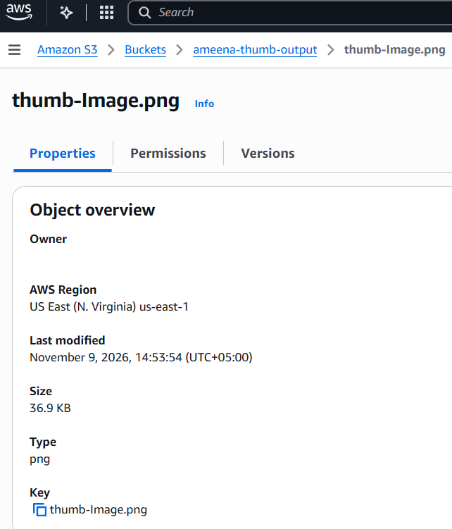
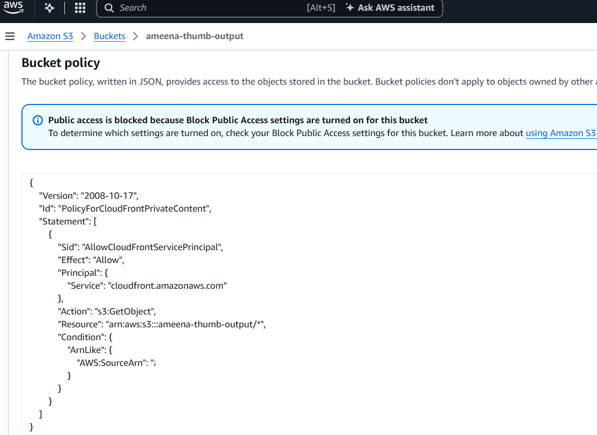
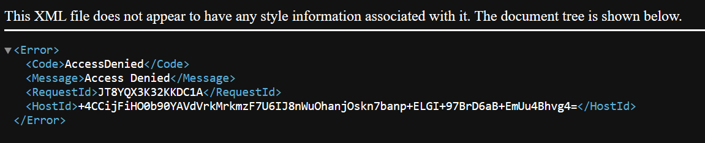

# serverless-thumbnail-generator
A serverless image-processing solution built using Amazon S3, AWS Lambda (Python and Pillow), and Amazon CloudFront. The system automatically processes images uploaded to an S3 bucket, generates optimized thumbnails using Lambda, and securely delivers them to users through CloudFront, ensuring efficient, scalable, and reliable image delivery.

## Overview
A serverless image-processing pipeline on AWS. When an image is uploaded to an S3 bucket, a Lambda function is triggered automatically. It generates a smaller thumbnail and saves it to a separate private S3 bucket. The thumbnail is then served securely through CloudFront.

## Architecture

## Services Used
- **Amazon S3**: one bucket for original uploads and a separate private bucket for thumbnails
- **AWS Lambda (Python 3.12)**: resizes the image when it is uploaded
- **Lambda Layer (Pillow)**: provides the image-processing library
- **AWS IAM**: execution role with a least-privilege inline policy
- **Amazon CloudFront (with OAC)**: serves thumbnails from the private bucket
- **Amazon CloudWatch Logs**: used to debug Lambda executions

## How It Works
1. An image is uploaded to the upload bucket.
2. The S3 event notification triggers the Lambda function.
3. Lambda downloads the image and resizes it using Pillow.
4. The thumbnail is saved to the output bucket (set through the `THUMB_BUCKET` environment variable).
5. The output bucket stays private. CloudFront reads from it using Origin Access Control (OAC), and the bucket policy allows only that CloudFront distribution.
6. Opening the thumbnail through the CloudFront URL works, while accessing the S3 object URL directly returns Access Denied.

The Lambda code is in [lambda_function.py](lambda_function.py).

## Implementation Summary
- Created two S3 buckets: one for uploads, one for thumbnails
- Built a Pillow Lambda layer (installed with pip and zipped in CloudShell)
- Created the Lambda function (Python 3.12, 256 MB memory) and attached the layer
- Added an S3 trigger on the upload bucket
- Added an inline IAM policy so Lambda can read from the upload bucket and write to the output bucket
- Created a CloudFront distribution with OAC and updated the output bucket policy

## Challenges Faced
**Problem:** After uploading an image, no thumbnail appeared in the output bucket. The CloudWatch logs showed an `AccessDenied` error for `s3:GetObject`.

**Cause:** The Lambda execution role did not have permission to read from the upload bucket.

**Fix:** I added a least-privilege inline policy (`thumbnail-s3-access`) that allows only `s3:GetObject` on the upload bucket and `s3:PutObject` on the output bucket. After that, the thumbnail was created successfully (1.1 MB original reduced to 36 KB).

**Note:** The thumbnail is saved to a different bucket than the trigger bucket. Using the same bucket would cause Lambda to trigger itself in an infinite loop.

## Key Learnings
- Lambda needs explicit IAM permissions for every S3 action it performs
- CloudWatch logs are the first place to look when a Lambda function fails
- A successful `REPORT` line in the logs does not mean the function worked, so the actual error needs to be read
- Lambda layers keep libraries like Pillow separate from the function code
- CloudFront with OAC lets a bucket stay private while content is still served securely
- Use a separate output bucket to avoid recursive Lambda triggers

## Future Improvements
- Store image metadata (name, size, upload time) in DynamoDB
- Add API Gateway so users can upload images or fetch thumbnails through an API
- Support multiple thumbnail sizes
- Add error handling and a dead-letter queue (SQS) for failed images

## Screenshots

### 1. S3 Buckets (upload + thumbnail)

### 2. Pillow Lambda Layer

### 3. Lambda Execution Role Permissions

### 4. S3 Trigger on Lambda

### 5. Layer Attached to Lambda

### 6. Original Image (1.1 MB)

### 7. Generated Thumbnail (36 KB)

### 8. CloudFront Distribution

### 9. Bucket Policy (OAC)

### 10. Direct S3 Access Denied (bucket is private)

### 11. Thumbnail Served via CloudFront

## Cleanup
After testing, all resources (CloudFront distribution, S3 buckets, Lambda function and layer) were deleted to avoid charges.
