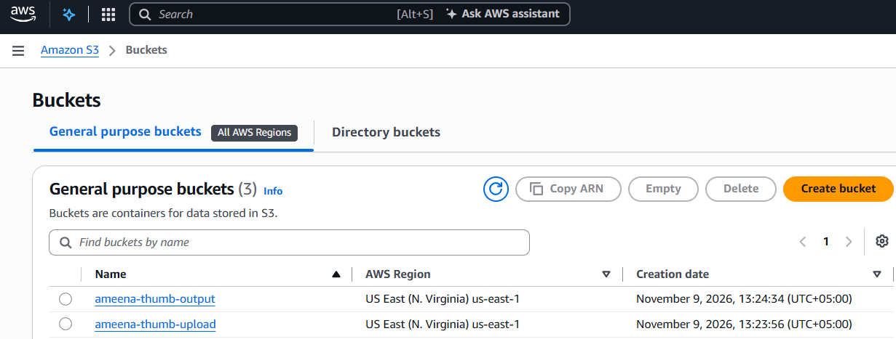
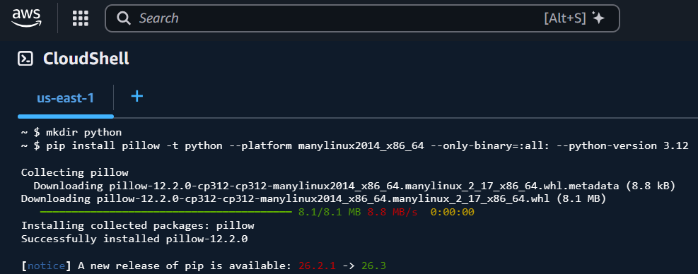
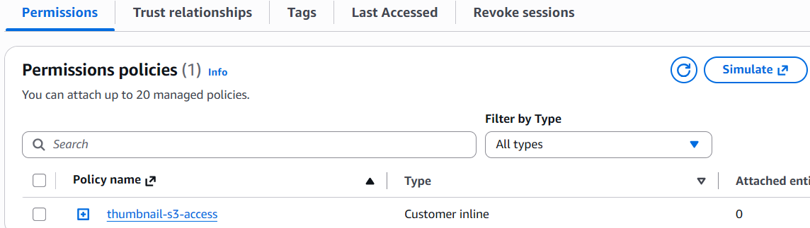
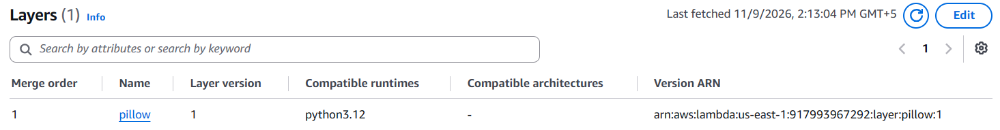
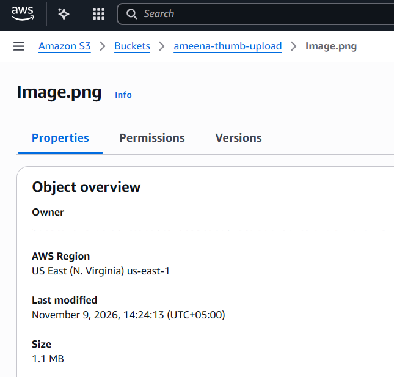
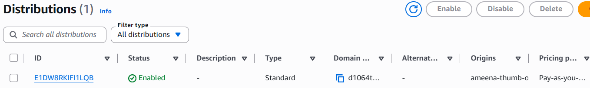
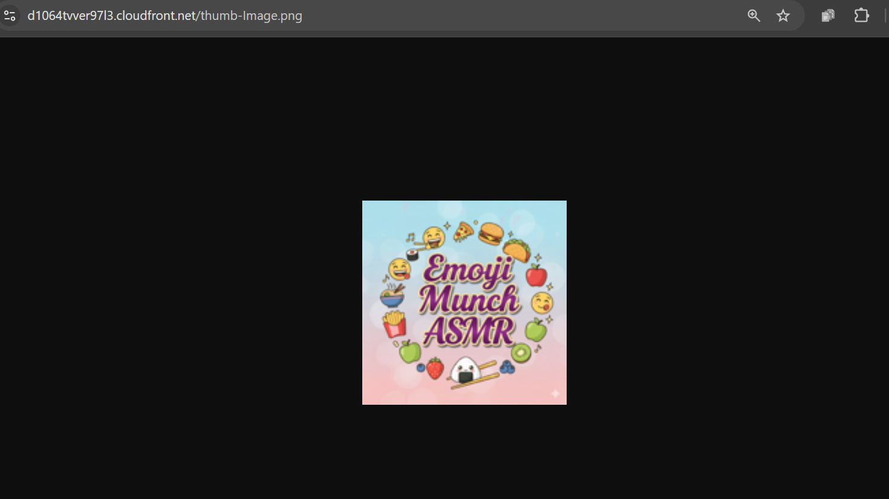

# serverless-thumbnail-generator
Serverless image thumbnail generator on AWS using S3, Lambda (Python, Pillow) and CloudFront.
## Screenshots

### 1. S3 Buckets

### 2. Pillow Lambda Layer

### 3. Lambda Permissions

### 4. S3 Trigger

### 5. Layer Attached

### 6. Original Image (1.1 MB)

### 7. Generated Thumbnail (36 KB)

### 8. CloudFront Distribution

### 9. Bucket Policy (OAC)

### 10. Direct S3 Access Denied

### 11. Thumbnail via CloudFront

